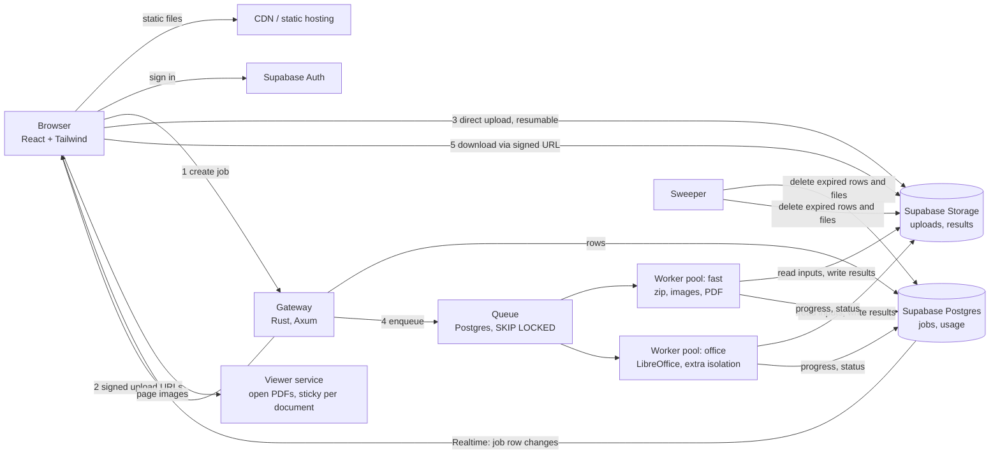

# OrangeFile on the web: what exists, and the backend I recommend

Status of this document: sections 1 and 7 (Phase 1) describe what is built; sections 3 to 6 are the longer-term proposal (Phase 2 onward) and are **not** implemented.
How to publish Phase 1: see `DEPLOY.md`.

## 1. What exists today

```
Browser (web/, React + Tailwind)  ──same-origin /api/v1──▶  something that authenticates  ──▶  crates/file-api (Axum)  ──▶  crates/file-core (engines)
```

* `web/` is a complete browser version of the app: dashboard, convert, compress, extract, merge, split, images to PDF, PDF to images,
  documents to PDF (LibreOffice), and the PDF editor (reorder, rotate, delete, extract, annotate, save a copy). It is driven by the engine's
  capability report, so a tool the server can't run is shown with the reason and is not clickable.
* The browser holds **no secret**. It calls same-origin `/api/v1/...`. In development, `npm run dev:all` starts the Rust engine and the Vite
  dev server; the dev server's proxy adds the engine's random token and removes the `Origin` header the engine refuses from web pages.
* Verified on Linux against the real engine (real PDFium, real LibreOffice 24.2) by `web/tests/e2e.mjs`: it uploads files in a browser,
  downloads the results and inspects them (page counts, pixel colours of annotations, ZIP contents), and runs axe accessibility checks in
  light and dark.

**Two modes of `crates/file-api`.**

* **Local** (the desktop app, `npm run dev:all`): loopback only, one shared bearer token, no limits beyond the engine's. Do not expose it.
* **Hosted** (`FILE_API_MODE=hosted`, built and tested): a public single-machine server. Every visitor is **anonymous** and gets a signed session
  from `POST /api/v1/session` (token `of1.<id>.<expiry>.<signature>`, HMAC-SHA256, 24 h, renewed by the web app). Every job and open PDF belongs to
  its session and anyone else gets "not found". Limits per session and per IP (file size, job size, files, concurrent jobs, daily bytes, jobs per hour,
  sessions per IP per hour), a host allowlist, a same-origin rule, signed 2-minute download links (so plain `<a href>` downloads work), and the web app is
  served by the same process with a strict CSP. State (jobs, quotas) lives in that machine, so it is **one machine only**.

The web app detects the mode on its own: `POST /session` answering 404 means local mode (no token needed); otherwise it keeps the session in `localStorage`.

## 2. Principles for the hosted version

1. **One contract, many deployments.** The React app talks to `/api/v1` and reads `/capabilities`. It must not need to know whether the server is
   a desktop's local engine, a single VPS, or a cluster. The hosted version changes *how bytes move*, not what the screens do.
2. **Keep the Rust engines.** `file-core` (sandboxed PDFium worker, LibreOffice runner, safe archive extraction, tests) is the valuable part. The web
   backend wraps it; it does not rewrite it.
3. **Every upload is hostile.** ZIPs, PDFs and Office files are the classic attack surface. Parsing happens in a process that can't reach anything.
4. **Short retention, no content in logs.** The product promise is "deleted soon after you download". Design for it, don't bolt it on.
5. **The data plane and the compute plane are separate.** Users, rows and files live in Supabase. Conversion runs on machines you control.

## 3. Recommended architecture



### The pieces

| Piece | Job | Notes |
|---|---|---|
| **Web app** (`web/dist`) | The UI | Static files on any CDN (Vercel, Cloudflare Pages, Netlify). Talks only to the gateway, Supabase Auth and signed Storage URLs. |
| **Supabase Auth** | Accounts | Email link, Google/Apple, passkeys. **Anonymous sign-in** gives a "try it without an account" tier with tight quotas. The gateway checks the JWT on every request. |
| **Supabase Postgres** | `jobs`, `job_files`, `usage_daily`, plans | Row Level Security so a user can only read their own rows. Doubles as the **queue** (`select … for update skip locked`, or the `pgmq` extension): no Redis needed to start. |
| **Supabase Storage** | Uploads and results | Two private buckets. Browser uploads **directly** with signed URLs (resumable/TUS for big files); the gateway never carries file bytes. Downloads use short-lived signed URLs. |
| **Supabase Realtime** | Live progress | The browser subscribes to its own job row; the gateway endpoint `GET /jobs/{id}` stays as the fallback (the UI already polls it). |
| **Gateway** (new crate, Rust/Axum) | The only public API | Verifies the JWT, runs the same pre-checks as `/jobs/preview` (file types by content, options, limits), checks quotas, creates the job row, hands out upload URLs, enqueues, returns status and signed download URLs. Stateless, so it scales by adding copies. |
| **Workers** (new binary, Rust) | Do the work | One binary: `file-core` + PDFium (+ LibreOffice in the office image). Claims a job, downloads inputs to a private temp dir, runs `file_core::request::run_with`, uploads outputs, writes the manifest and status. **Two pools:** `fast` and `office`, scaled independently. |
| **Viewer** (the existing open-document code) | PDF page pictures for the editor | The one stateful piece: a document stays open between page requests. Route by document id (sticky) and start with a single instance. |
| **Sweeper** | Retention | Deletes expired job rows **and their files through the Storage API** (see caveats). |

### A job, step by step
1. `POST /jobs` with the operation, options and, for each file, only `{name, size, first 32 bytes}`. The gateway validates (this is the existing preview logic), checks the quota, inserts the job as `uploading`, and returns signed upload URLs.
2. The browser uploads straight to Storage, with progress.
3. `POST /jobs/{id}/start` marks it `queued`. (A Storage webhook can do this instead.)
4. A worker claims it, runs it in the sandbox, writes results, sets `completed` and `expires_at`.
5. The browser sees the change through Realtime, then downloads through a signed URL. Several results are bundled into a ZIP by the worker, so the gateway never streams.
6. At `expires_at` the sweeper deletes the row and every object.

**Passwords** for PDFs and ZIPs are job options but must never sit in Postgres in plain text. Encrypt them in the gateway with the worker's public key (a sealed box), store only the ciphertext, and clear it when the job starts.

**Saving an edited PDF without uploading it twice.** Today the editor uploads the PDF to view it and again to save a copy. In hosted mode a job input can be `{ "ref": "doc_…" }`, a document the viewer already holds, so the save needs no second upload.

## 4. Where Supabase fits, and where it does not

I agree with Supabase for **auth, the database and files**. It replaces three things you would otherwise build and run, and Row Level Security gives you per-user isolation in the database itself. Points to know before committing (check current Supabase documentation and pricing, because limits change):

* **It is not compute.** Edge Functions can't run PDFium or LibreOffice (native binaries, CPU and time limits). You still need your own container hosts for workers: Fly.io, Railway, Hetzner, or AWS. Supabase is the data plane only.
* **File size limits.** Storage has a global per-file limit that depends on the plan, and large files need the resumable upload protocol. The local engine accepts 8 GiB per file; a hosted service should choose a deliberate, much smaller limit (for example 100 to 500 MB) and show it in the capability report.
* **Deleting files.** Remove objects through the **Storage API**, not by deleting rows in SQL, or the underlying files may stay. The sweeper must use the service key.
* **Retention.** Don't rely on any built-in expiry. The sweeper, plus a short `expires_at`, is the mechanism.
* **Privacy.** On the web, files do pass through a third party and your workers. The desktop promise "everything stays on this computer" does not hold, and the web copy must say what does hold (deleted after N minutes, region, no content in logs). Choose the EU region if your users are in Europe, and sign the data-processing terms.
* **Lock-in.** Put storage behind a small interface (`BlobStore`: put, signed-url, delete) so moving to S3-compatible storage, or self-hosted Supabase, is a change in one place.
* **Keys.** The service-role key lives only in the gateway, workers and sweeper. The browser gets the public anon key and a user JWT. Nothing else.

## 5. Security checklist

* **Identity:** gateway validates the Supabase JWT (JWKS) on every call; job ids are UUIDs *and* ownership is checked; RLS on every table.
* **Uploads:** type decided by content (already done in `file-core::formats`), file count and size caps enforced by the signed upload policy *and* again by the worker, zip-bomb and path-traversal defences (already done and tested).
* **Sandbox:** worker runs as a non-root user, read-only root filesystem, private tmpfs work directory, CPU/memory/process limits, wall-clock timeout, and **no network** for the engine process itself (download inputs first, then run the engine in a child with the network namespace removed, for example with nsjail or bubblewrap). The `office` pool gets stronger isolation (gVisor or a micro-VM), because office parsers are the riskiest code here. Every conversion already uses a fresh LibreOffice profile with macros off.
* **Abuse:** per-user and per-IP concurrent jobs, daily byte quotas, Turnstile/hCaptcha for anonymous users, Cloudflare in front, optional ClamAV scan before processing.
* **Browser:** strict CSP, `Content-Disposition: attachment` and `nosniff` on every download (already set by the engine), signed URLs with short lifetimes. Use the Supabase session as a Bearer token (no cookies, so no CSRF); downloads use signed URLs, so plain links keep working.
* **Logging:** request ids (already present), job ids and sizes only; **never** file names, contents or passwords.

## 6. Scaling and cost

* Throughput is CPU-bound in the workers; one LibreOffice conversion uses about one core. Scale each pool on queue depth.
* Cost drivers are storage retention, egress, and the office pool. Keep retention at an hour or less, cap sizes by plan, and keep office conversions on their own small, autoscaled pool.
* The gateway is cheap and stateless; the viewer is the only thing that needs affinity.

## 7. Delivery in phases

| Phase | What | Result | Rough effort |
|---|---|---|---|
| **0 (done)** | React + Tailwind web UI on the existing local engine; `npm run dev:all` | Works for you, on a trusted machine | done |
| **1: single hosted server (built; deploy with `DEPLOY.md`)** | `hosted` mode in `file-api`: anonymous signed sessions (no sign-up), job ownership, quotas per session and per IP, host/origin checks, signed download links, web app served by the same process, container for Fly.io (one machine, files on its disk, 100 MB per file). **Supabase is not used yet.** | A first public beta for hundreds of users | built; deploy and observe |
| **2a: Supabase for data only (next, small)** | The server, not the browser, writes one row per finished job (operation, sizes, duration, outcome; never names or content) to a Postgres table using Supabase's secret key kept in a Fly secret. Row Level Security on, no public policies. Gives you usage statistics. | Numbers about real use | a few days |
| **2: Supabase data plane** | `jobs` table, direct signed uploads, Realtime progress, Postgres queue, separate worker binary and pools, sweeper, `ref` inputs | Horizontally scalable, stateless gateway | 4 to 6 weeks |
| **3: hardening and growth** | gVisor/micro-VM for the office pool, sticky viewer, billing (Stripe), virus scan, API keys, teams, audit log | Ready for paying customers | ongoing |

Changes the web app needs along the way are small because `web/src/lib/api.ts` is the only file that knows about transport: `createJob` becomes "create, upload to signed URLs, start", result links become `api.downloadUrl(job)`, and `limits.upload_mode` in the capability report tells the UI which flow to use.

## 8. Alternatives considered

* **Gateway in Node/NestJS.** Faster for accounts and billing screens, but it duplicates types and still needs Rust workers. Workers talk to the gateway only through the database, so the gateway language is replaceable later. I recommend Rust first only because the engine types are already there.
* **Process in the browser (WebAssembly).** Possible for images, merge, split and annotations; it removes server cost and is a privacy win. It cannot run LibreOffice. A hybrid (light operations in the browser, Office on the server) is a good later optimisation.
* **Serverless function per job.** Cold starts, native binaries and time limits make this a poor fit for LibreOffice.

## 9. Decisions I need from you

Decided: anonymous use without sign-up; 100 MB per file; conversion on Fly.io; Supabase for stored data only.

Still open:

1. **Is a session in the browser enough as "identity"?** It limits and separates visitors but cannot follow someone across devices or recover jobs after clearing browser data. Accounts (Supabase Auth) would, and would also allow per-user plans. Fine for a free beta; revisit before paid plans.
2. **Other limits:** files per job (20), job size (300 MB), daily volume (600 MB), one concurrent job. Right for a free tier?
3. **Region:** the proposed `fly.toml` uses Paris. Same question for the Supabase project (EU).
4. **Business model:** free with limits, paid plans, or internal tool? It decides whether billing is Phase 3 or Phase 1.
5. **Abuse protection:** add a CAPTCHA (Cloudflare Turnstile) before you promote the site publicly?
